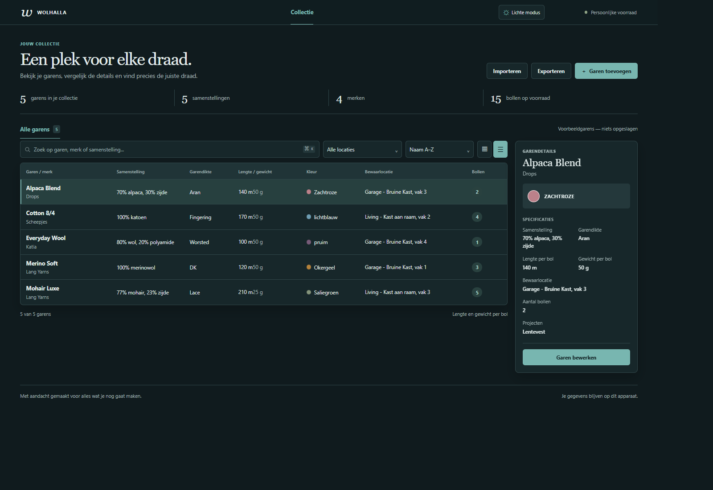

# Wolhalla

Wolhalla is een browserapp om je garenvoorraad en projecten bij te houden. De
app werkt zonder account of server en kan als statische site op GitHub Pages
draaien.

[Open de live app](https://dannyvaneeckhoutte.github.io/Wolhalla/) ·
[Bekijk versie v1.3.0](https://github.com/dannyvaneeckhoutte/Wolhalla/tree/v1.3.0)

## Functies

- Garen beheren met Nederlandse kleurnamen, merk, dikte, samenstelling, lengte in meters, gewicht per bol, bewaarlocatie en aantal bollen.
- Garen toewijzen aan een van de vier vakken in de bruine kast in de garage of de kast aan het raam in de living.
- Voorraad met overzichtscijfers bekijken, filteren op bewaarlocatie, zoeken en sorteren op alle specificaties.
- Garendetails bekijken door een item te selecteren; de weergave past zich aan desktop, tablet en mobiel aan.
- Voorraad standaard als lijst bekijken of op grotere schermen naar miniaturen wisselen; projecten aan garens koppelen.
- Bij een lege voorraad vijf tijdelijke voorbeeldgarens bekijken; deze worden niet opgeslagen of in back-ups opgenomen.
- De app standaard in donkere modus gebruiken of overschakelen naar de lichte modus.
- Je voorraad bewaren in de browser en back-ups exporteren of importeren.

De kleurnamen volgen de CSS-namen uit de
[MDN-kleurenlijst](https://developer.mozilla.org/en-US/docs/Web/CSS/Reference/Values/named-color),
met Nederlandse labels.

## GitHub Pages

De workflow [`pages.yml`](./.github/workflows/pages.yml) publiceert de inhoud
van [`web/`](./web/) na een push naar `main`. Schakel onder
**Settings > Pages** de publicatiebron **GitHub Actions** in.

## Gegevens en lokaal gebruik

De voorraad wordt lokaal in IndexedDB van je browser bewaard. Ze wordt niet
gesynchroniseerd met andere browsers of apparaten. Een back-up importeren
vervangt de huidige voorraad. Back-ups van versie 1 met lengtes in yards blijven
importeerbaar; deze worden bij het importeren naar meters omgerekend.

Open de bestanden in `web/` via een lokale statische webserver om de app lokaal
te gebruiken; er zijn geen pakketinstallaties of buildstappen nodig.

Zie [project/STRUCTURE.md](./project/STRUCTURE.md) voor de projectindeling.
